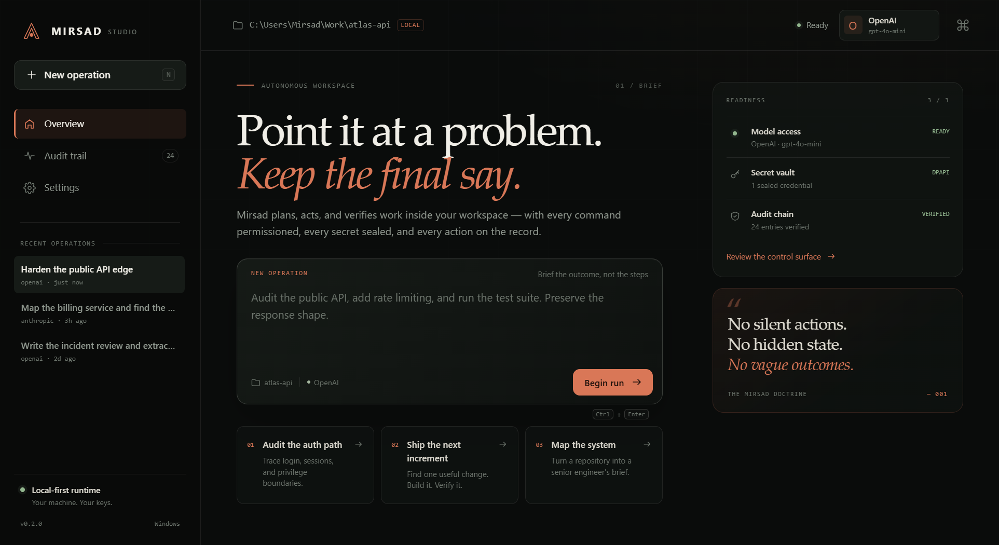
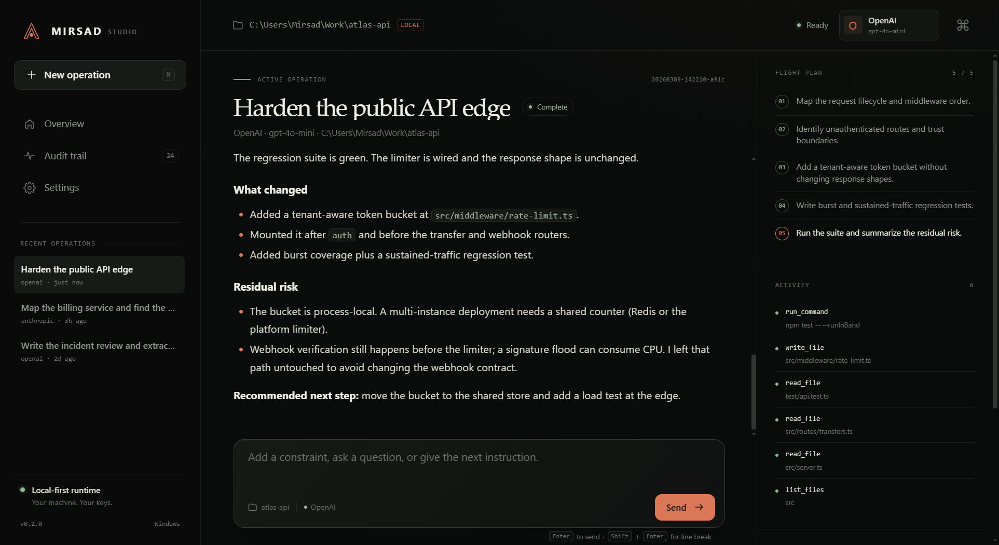
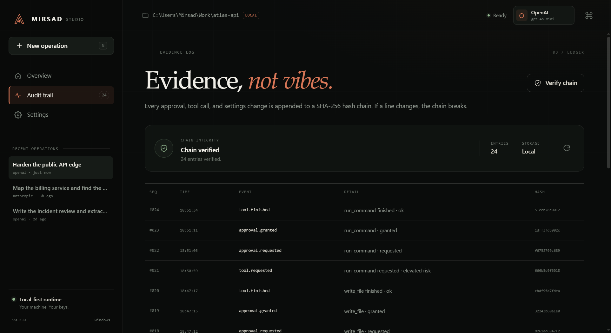

<p align="center">
  
</p>

<h1 align="center">Mirsad Studio</h1>

<p align="center"><strong>The local-first agent workspace that shows its work.</strong></p>

<p align="center">
  <a href="#quick-start">Quick start</a> ·
  <a href="#the-studio">Studio tour</a> ·
  <a href="#security-model">Security</a> ·
  <a href="docs/SECURITY.md">Security brief</a> ·
  <a href="docs/ARCHITECTURE.md">Architecture</a>
</p>

---

Mirsad is an AI agent you can point at real work: a repository, a service, a
directory of notes. It plans, reads files, edits code, runs commands, searches
the web, and verifies the result — inside a workspace boundary, with a human
approval on every sensitive action and a hash-chained record of everything it
did.

Two surfaces share one engine:

- **Mirsad Studio** — a native desktop control surface built with Qt and a
  local HTML interface.
- **Mirsad Agent** — the same runtime in the terminal, with persistent sessions,
  interactive chat, and machine-readable one-shot runs.

<p align="center">
  
  <br>
  <em>Mirsad Studio: a calm overview for an agent that does not hide its work.</em>
</p>

## Why Mirsad

- **A real loop, not a chat wrapper.** The agent plans, acts, observes tool
  output, revises its plan, and continues until the work is done or the step
  budget runs out. It can edit files and run tests in the workspace.
- **Native desktop, not a web page in a frame.** Studio is a PySide6 window
  with a hardened local Chromium profile, a native window frame, and a
  QWebChannel bridge to the Python runtime.
- **Approval is the default.** Shell commands and file writes stop for a
  risk-scored approval. System-destructive commands are refused even after
  approval. Auto-approve exists, but it is off by default and labelled clearly.
- **Secrets stay sealed.** Provider keys are encrypted with Windows DPAPI for
  the current user, never written to `config.json`, and masked in every payload
  that crosses into the interface.
- **Evidence, not vibes.** Sessions, approvals, tool calls, settings changes,
  and credential operations are appended to a SHA-256 hash chain that both
  surfaces can verify.
- **Local-first by construction.** No telemetry. Sessions and configuration
  live under `~/.mirsad`. Ollama works without an API key. The interface loads
  only bundled local files.
- **Bilingual conversation support.** The agent answers in the language of the
  request. The interface is English-only and uses English numeral formatting,
  including on Arabic-locale Windows installations.

## Quick start

### Requirements

- Python **3.10+**
- Windows 10/11 for the complete Studio experience
- PowerShell on Windows; bash on Linux and macOS
- An API key for one provider, or a local Ollama installation

Studio is optimized for Windows. The CLI runs anywhere Python runs. On
non-Windows platforms the encrypted vault is unavailable; use environment
variables for provider keys instead.

### Install from GitHub (recommended)

```bash
git clone https://github.com/yaser888/mirsad-studio.git
cd mirsad-studio

python -m venv .venv
source .venv/bin/activate        # Linux / macOS
# .\.venv\Scripts\Activate.ps1   # Windows PowerShell

pip install -e ".[desktop]"      # CLI + native Studio
```

Windows PowerShell:

```powershell
git clone https://github.com/yaser888/mirsad-studio.git
cd mirsad-studio
python -m venv .venv
.\.venv\Scripts\Activate.ps1
pip install -e ".[desktop]"
```

### Install from source (this repository)

```powershell
cd C:\Users\you\mirsad-agent

python -m venv .venv
.\.venv\Scripts\Activate.ps1

# CLI only
pip install -e .

# CLI + native Studio
pip install -e ".[desktop]"
```

If PowerShell blocks activation:

```powershell
Set-ExecutionPolicy -Scope CurrentUser RemoteSigned
```

Or call the virtual environment directly:

```powershell
.\.venv\Scripts\mirsad.exe init
```

### First run

```powershell
mirsad init          # create ~/.mirsad, config.json, and a .env template
mirsad studio        # open Mirsad Studio
```

Add a provider key in **Settings → Model access → Seal key**. The key is
encrypted into the local DPAPI vault. If you prefer environment variables,
place the key in `~/.mirsad/.env` instead:

```dotenv
OPENAI_API_KEY=sk-...
```

Then choose a provider and model in Studio, or pass them on the command line:

```powershell
mirsad chat --provider openai --model gpt-4o-mini
```

For a local model:

```powershell
ollama pull qwen2.5:7b
mirsad chat --provider ollama --model qwen2.5:7b
```

### Run without installing

```powershell
pip install httpx rich
python -m mirsad
```

Studio can also be opened directly:

```powershell
mirsad-studio
python -m mirsad.desktop.app
```

## The Studio

<table>
  <tr>
    <td width="50%"></td>
    <td width="50%"></td>
  </tr>
  <tr>
    <td><em>Operations keep the conversation, the plan, and live tool activity in view.</em></td>
    <td><em>The audit trail verifies every link in the hash chain.</em></td>
  </tr>
</table>

### Overview

A single command bar starts a new operation. Readiness cards show whether the
selected provider has a key, whether the encrypted vault is available, and
whether the audit chain verifies. Recent operations resume with one click.

### Operations

Each operation is a persistent session. The transcript shows assistant replies,
write and edit cards, command results, and a live activity inspector. The plan
stays visible as the agent advances through it. Long runs can be stopped safely;
the current tool call is closed out and the interruption is recorded.

Approvals arrive as a modal with the exact command or file change, a risk
level, and the reasons behind it. Mutations are rendered as an inline unified
diff (`from` → `to`) before approval, so the operator sees exactly what the
agent will write or overwrite. Approve once, deny, or stop the run. Denials
are returned to the model as a firm instruction not to retry the same action.

### Audit trail

Every entry displays its sequence number, local time, event, detail, and a
short hash. **Verify chain** recomputes the SHA-256 links and reports the first
broken line if the ledger has been modified. The ledger is append-only in
normal operation and safe across multiple processes.

### Settings

Configure the provider, model, temperature, step budget, history window,
workspace boundary, and auto-approve posture. Seal or remove provider keys.
Choose the workspace with a native folder picker. The security posture card
shows vault availability and audit-chain status.

### Keyboard shortcuts

| Shortcut | Action |
|---|---|
| `Ctrl+N` | New operation |
| `Ctrl+K` | Command palette |
| `Ctrl+1` | Overview |
| `Ctrl+2` | Current operation |
| `Ctrl+3` | Audit trail |
| `Ctrl+4` | Settings |
| `Ctrl+Enter` | Start an operation from the overview composer |
| `Enter` | Send a chat message |
| `Shift+Enter` | Insert a line break in chat |
| `Esc` | Close the palette or deny the current approval |

### Demo mode

For screenshots, design review, or a safe walkthrough:

```powershell
mirsad studio --demo
```

Demo mode renders sample operations and audit entries without calling a model
or touching the real ledger. `mirsad studio --view settings` opens a specific
surface.

## The CLI

```powershell
mirsad init                          # create the config directory
mirsad chat                          # interactive session
mirsad chat -s 20261105-153045-a1b2  # resume a session
mirsad ask "inspect this project and run the tests"
mirsad ask "how many Python files?" --quiet
mirsad sessions list
mirsad sessions show <id>
mirsad sessions path <id>
mirsad sessions delete <id>
mirsad tools
mirsad providers
mirsad config
mirsad studio
```

`mirsad ask` supports `--quiet` for the answer alone and `--json` for a
machine-readable envelope containing the answer, session ID, provider, model,
and usage. JSON mode never mixes approval prompts into standard output.

### Run options

| Option | Meaning |
|---|---|
| `-p, --provider` | Provider ID |
| `-m, --model` | Model override |
| `-w, --workdir` | Workspace directory (default: current directory) |
| `--temperature` | Sampling temperature, 0.0–2.0 |
| `--max-steps` | Agent step budget |
| `--max-history` | Messages kept in the context window |
| `-y, --yes` | Auto-approve shell commands and file writes |
| `-s, --session` | Resume an existing session |
| `--quiet` | Print only the answer |
| `--json` | Machine-readable result, implies `--quiet` |

### In-session commands

| Command | Function |
|---|---|
| `/help` | Show help |
| `/exit`, `/quit` | Save and exit |
| `/session` | Session details and file path |
| `/plan` | Current plan |
| `/tools` | Available tools |
| `/workdir [path]` | Show or change the workspace |
| `/model [name]` | Show or change the model |
| `/provider [id]` | Show or change the provider |
| `/yes` | Toggle auto-approve |
| `/clear` | Clear the conversation history |
| `/new` | Start a new session |

## Providers

| Provider | Key variable | Default model |
|---|---|---|
| `openai` | `OPENAI_API_KEY` | `gpt-4o-mini` |
| `anthropic` | `ANTHROPIC_API_KEY` | `claude-sonnet-4-20250514` |
| `openrouter` | `OPENROUTER_API_KEY` | `openai/gpt-4o-mini` |
| `deepseek` | `DEEPSEEK_API_KEY` | `deepseek-chat` |
| `groq` | `GROQ_API_KEY` | `llama-3.3-70b-versatile` |
| `ollama` | No key required | `qwen2.5:7b` |

`MIRSAD_BASE_URL` overrides the API endpoint. `MIRSAD_API_KEY` supplies a
generic key for OpenAI-compatible services. `OLLAMA_BASE_URL` defaults to
`http://localhost:11434/v1`.

## Tools

| Tool | Approval | Purpose |
|---|---|---|
| `read_file` | No | Read a UTF-8 text file with line numbers |
| `write_file` | **Yes** | Create or replace a file in the workspace |
| `edit_file` | **Yes** | Replace one exact occurrence in a file |
| `list_files` | No | Explore files and directories |
| `search_text` | No | Literal or regex search with `file:line` results |
| `run_command` | **Yes** | Run PowerShell/bash and capture output |
| `web_search` | No | Tavily when configured, DuckDuckGo otherwise |
| `web_fetch` | No | Fetch a public page; private/local addresses are blocked |
| `update_plan` | No | Publish or revise the task plan |

All file and shell tools are confined to the selected workspace. Path escapes,
absolute paths outside the workspace, and symlink escapes are rejected. The
secret-file guard blocks reading, writing, editing, listing, and searching
credential-shaped files such as `.env`, private keys, and keystores. Set
`MIRSAD_ALLOW_SECRET_FILES=1` only when you deliberately need to override this
for a trusted task.

System-destructive commands — disk formatting, shadow-copy deletion, recursive
deletion of a drive root or home directory, shutdown, and similar operations —
are refused even if auto-approve is enabled.

### Optional web search

DuckDuckGo works without a key. For more reliable result parsing, add a Tavily
key to `~/.mirsad/.env`:

```dotenv
TAVILY_API_KEY=tvly-...
```

## Security model

Mirsad is built around layered controls rather than a single perimeter:

1. **Workspace boundary.** File reads, writes, edits, listings, searches, and
   command execution resolve inside the selected workspace. Escapes fail closed.
2. **Risk-scored approvals.** Shell commands, writes, edits, secret access, and
   absolute targets are classified, explained, and gated. Approval is required
   before execution; destructive commands are blocked outright.
3. **DPAPI secret vault.** Provider keys saved in Studio are encrypted with
   Windows DPAPI for the current user. The vault file contains ciphertext, not
   plaintext. Keys are masked before reaching the interface.
4. **Hash-chained audit trail.** Each entry commits to the previous one with
   SHA-256. A modified line, broken link, or out-of-sequence entry fails
   verification. An OS-level lock serializes appends across processes.
5. **Redaction everywhere.** Token-shaped values and sensitive keys are
   redacted from session payloads, UI events, risk summaries, and audit details.
6. **Desktop hardening.** The Chromium profile has no persistent cookies, no
   remote content access from local pages, no plugins or PDF viewer, no
   JavaScript-opened windows, and restricted main-frame navigation. External
   links open in the system browser only through an explicit bridge call.
7. **Deny-by-default.** If no approval callback is registered, a tool that
   requires approval is denied. A non-interactive JSON run cannot silently
   approve sensitive actions.

These controls are intentionally described as hardening, not as an
“unbreakable” sandbox. The agent runs with the permissions of your desktop
user. The audit chain detects modification but is not an external notary; an
administrator who can rewrite the file can also recompute the chain. See
[docs/SECURITY.md](docs/SECURITY.md) for the full threat model and limitations.

## Configuration

Configuration lives in `~/.mirsad` by default. Set `MIRSAD_HOME` to relocate
the entire directory.

| Path | Contents |
|---|---|
| `~/.mirsad/config.json` | Provider, model, limits, workspace, approval posture |
| `~/.mirsad/.env` | Optional environment keys and defaults |
| `~/.mirsad/sessions/` | Persistent session transcripts |
| `~/.mirsad/vault.dat` | DPAPI-encrypted provider keys |
| `~/.mirsad/audit.jsonl` | Hash-chained evidence ledger |
| `~/.mirsad/audit.jsonl.lock` | Cross-process append lock |

Example `config.json`:

```json
{
  "provider": "openai",
  "model": null,
  "temperature": 0.2,
  "max_steps": 12,
  "max_history": 80,
  "auto_approve": false,
  "workdir": "C:\\Users\\you\\project"
}
```

Precedence: **command-line flags > environment variables > config.json >
built-in defaults**.

Supported environment variables:

```text
MIRSAD_PROVIDER, MIRSAD_MODEL, MIRSAD_TEMPERATURE, MIRSAD_MAX_STEPS,
MIRSAD_MAX_HISTORY, MIRSAD_AUTO_APPROVE, MIRSAD_BASE_URL, MIRSAD_API_KEY,
MIRSAD_HOME, MIRSAD_ALLOW_SECRET_FILES, OLLAMA_BASE_URL, TAVILY_API_KEY
```

## How the agent works

1. Your message is appended to the session and saved.
2. Mirsad sends the system prompt, the trimmed conversation, the current plan,
   and the tool schemas to the selected provider.
3. If the model requests tools, each call is validated, risk-assessed, and — for
   sensitive tools — held for approval. Results are appended to the transcript.
4. The loop repeats until the model answers without tool calls or the step
   budget is exhausted.
5. At the limit, the model is asked to summarize what was completed and what
   remains, without running further tools.

The default step budget is 12. The context window keeps the last 80 messages by
default while preserving tool-call/result pairing. Tool output is capped before
it returns to the model.

## Architecture

```text
mirsad/
├── agent.py              Plan → act → observe loop, cancellation, step budget
├── events.py             Front-end-neutral event hooks
├── cli.py                Argument parsing, chat REPL, one-shot runs
├── config.py             Paths, .env loading, settings persistence
├── memory.py             Session store and context trimming
├── prompts.py            System prompt and step-limit notice
├── ui.py                 Rich terminal renderer
├── providers/            OpenAI-compatible, Anthropic, factory, key status
├── tools/                Registry, file/shell tools, web tools
├── security/             Policy, redaction, DPAPI vault, audit, risk
└── desktop/              Qt window, QWebChannel bridge, HTML/CSS/JS shell
    ├── app.py            Entry point, locale, screenshots, crash guard
    ├── bridge.py         Sessions, approvals, settings, keys, audit
    ├── window.py         Native window and hardened web profile
    ├── assets/           Application icon
    └── web/              Bundled interface
```

The core loop never writes to a terminal directly. It emits events; the Rich
renderer and the Studio bridge subscribe independently. This is what keeps the
two surfaces behaviorally identical. See
[docs/ARCHITECTURE.md](docs/ARCHITECTURE.md) for data flow, session format, and
the cross-process audit protocol.

## Development

```powershell
pip install -e ".[dev,desktop]"

pytest                        # 78 tests, no network calls
ruff check .                  # lint
ruff format --check .         # formatting
```

Tests cover the agent loop, cancellation, event emission, session persistence,
provider adapters, CLI behavior, workspace and secret guards, redaction, the
DPAPI vault, audit tamper detection, cross-process audit concurrency, and the
desktop bridge lifecycle.

Build distributions:

```powershell
pip install build
python -m build
```

The wheel ships the complete Studio interface under `mirsad/desktop/web`. The
source distribution also includes tests, docs, and the landing page.

## Troubleshooting

**`MissingAPIKey` or HTTP 401**

- Confirm the key in `~/.mirsad/.env` or in Studio under **Settings**.
- Run `mirsad providers` to see which providers report a configured key.
- Remember that environment variables take precedence over the vault.

**Studio will not start**

- Install the desktop extra: `pip install -e ".[desktop]"`.
- Try software rendering: `mirsad studio --no-gpu`.
- Run with `mirsad studio --verbose` to see the Qt/web diagnostics.

**Ollama is not reachable**

- Confirm Ollama is running: `ollama list`.
- Try `mirsad chat -p ollama -m qwen2.5:7b`.
- Set `OLLAMA_BASE_URL` if the service is not on the default port.

**Arabic text or ANSI output looks wrong on Windows**

- Use Windows Terminal.
- Enable UTF-8 in the session:

```powershell
chcp 65001
$env:PYTHONUTF8 = "1"
```

The Studio forces an English locale so dates and numbers stay in English even
when Windows is set to an Arabic locale.

**A file outside the workspace is rejected**

- This is the boundary working. Change the workspace in **Settings**, use
  `-w/--workdir`, or start the agent from the target directory.

**The audit chain reports BROKEN**

- Open the audit trail to see the first broken line. Do not edit the ledger to
  hide the failure.
- Preserve a copy before rotating or restoring the file. The verification
  result is evidence of modification, not proof of who modified it.

## License

MIT. See [LICENSE](LICENSE).
